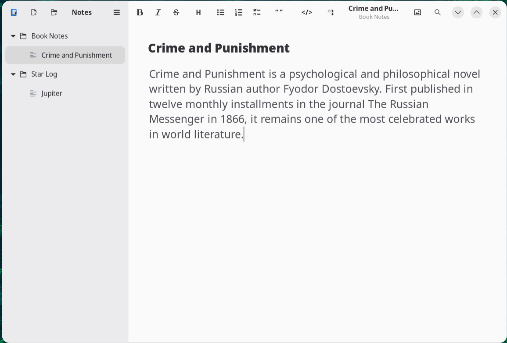

# Inkwell

A simple, native Markdown notes app for Linux. Think Obsidian with fewer moving parts: a sidebar of folders on the left, your note on the right, and everything saved as plain `.md` files in a folder you choose.



## Features

- Create, rename, move and delete notes and folders from the sidebar (right-click for the menu)
- Expandable folders; drag a note or folder onto another folder to move it
- Saves automatically as you type, and writes files atomically so a crash can't leave half a note
- Markdown highlighting, plus buttons and shortcuts for bold, italic, strikethrough, headings, lists, checklists, quotes, code and links
- Lists continue when you press Enter
- Find in note (Ctrl+F)
- Preferences (Ctrl+,) for the editor text size and a zoom that scales all text in the app (Ctrl+Plus, Ctrl+Minus, Ctrl+0)
- Follows the system light/dark style and adapts to narrow windows
- Picks up changes made by other programs, so you can sync the folder with Git, Syncthing, Nextcloud and so on

Your notes live in `~/Documents/Notes` by default. Change it from the menu with **Change Notes Folder…**. Deleting sends things to the Trash, not into the void.

## Running it

Inkwell is written in Python with GTK 4 and libadwaita. You need GTK 4.12 or newer, libadwaita 1.5 or newer, GtkSourceView 5 and PyGObject. That means Ubuntu 24.04, Fedora 40, Debian 13, Arch or anything newer.

Install the dependencies:

```sh
# Ubuntu / Debian
sudo apt install python3-gi gir1.2-gtk-4.0 gir1.2-adw-1 gir1.2-gtksource-5

# Fedora
sudo dnf install python3-gobject gtk4 libadwaita gtksourceview5

# Arch
sudo pacman -S python-gobject gtk4 libadwaita gtksourceview5
```

Then run it straight from the checkout:

```sh
python3 -m inkwell
```

To install it into your app menu (into `~/.local`, no root needed):

```sh
make install
```

Use `sudo make install PREFIX=/usr/local` for a system-wide install, and `make uninstall` (with the same `PREFIX`) to remove it.

## Keyboard shortcuts

| Keys | Action |
| --- | --- |
| Ctrl+N | New note |
| Ctrl+Shift+N | New folder |
| Ctrl+S | Save now |
| Ctrl+F | Find in note |
| Ctrl+B / Ctrl+I | Bold / italic |
| Ctrl+H | Cycle heading level |
| Ctrl+K | Insert link |
| Ctrl+Z / Ctrl+Shift+Z | Undo / redo |
| Ctrl+Plus / Ctrl+Minus | Zoom in / out |
| Ctrl+0 | Reset zoom |
| Ctrl+, | Preferences (editor text size and zoom) |
| Ctrl+Q | Quit |

## Development

```sh
make test        # unit tests for the file handling
```

The code is small and split by job:

- `inkwell/store.py` creates, renames, moves, reads and writes notes. It has no GTK code, so it is easy to test.
- `inkwell/sidebar.py` is the folder tree. Each folder watches the disk and updates itself.
- `inkwell/editor.py` is the title field, the text view, formatting commands and autosave.
- `inkwell/window.py` puts them together and holds the menus and dialogs.

For testing against a throwaway folder, set `INKWELL_NOTES_DIR=/some/folder` before starting the app.

## Licence

MIT, see [LICENSE](LICENSE).
